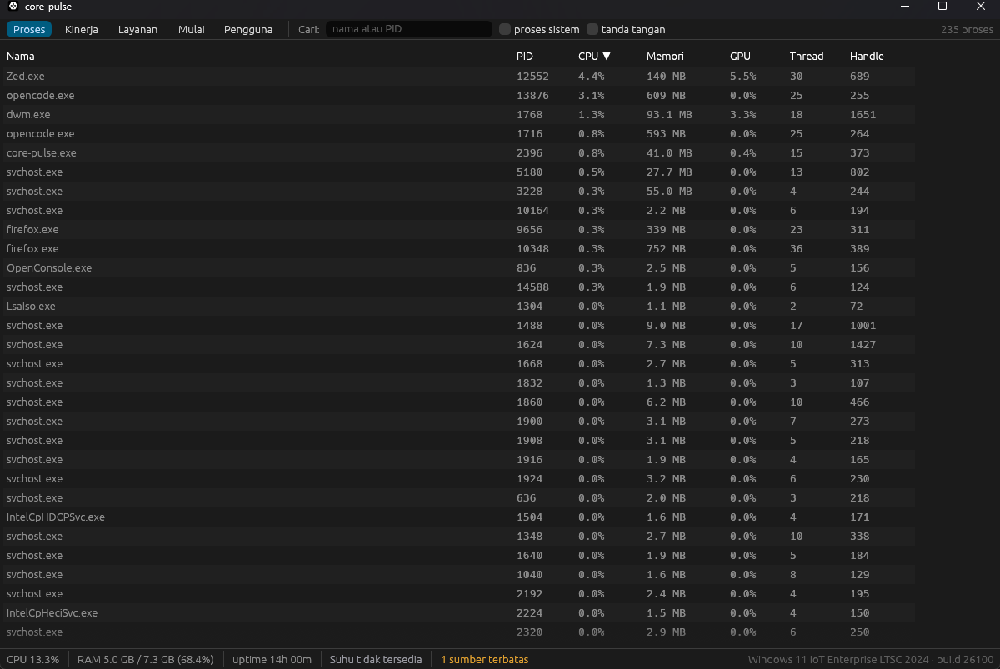
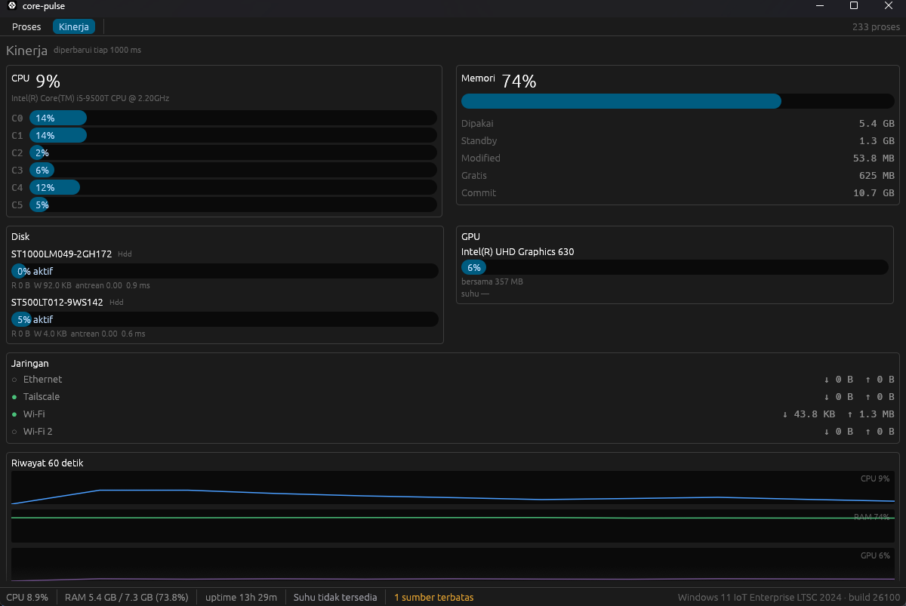
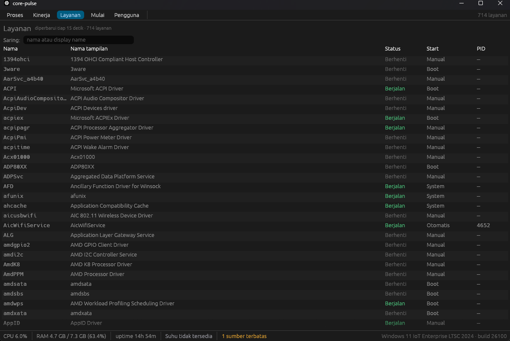
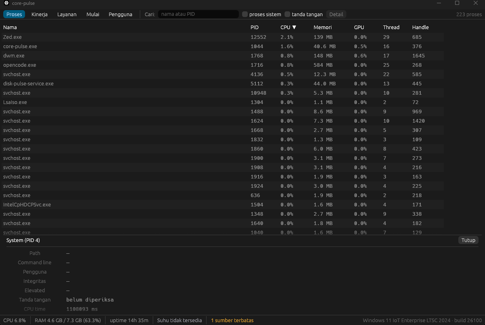

# core-pulse

Task manager untuk Windows dengan monitoring sensor suhu, ditulis dalam Rust.

`core-pulse` adalah penerus gagasan [disk-pulse](../disk-pulse): kalau `disk-pulse`
menjawab "seberapa sehat disk saya", `core-pulse` menjawab "apa yang sedang terjadi
di mesin ini sekarang, dan apakah ada yang kepanasan".

```
+-----------------------------+         named pipe          +-----------------------------+
|  core-pulse.exe             |  <-------------------->     |  core-pulse-helper.exe      |
|  UI (egui/eframe)           |      JSON snapshot          |  Windows Service (elevated) |
|  non-elevated               |                             |  sensor tier 3 + SMART      |
+-------------+---------------+                             +--------------+--------------+
              |                                                            |
              | ArcSwap<Snapshot>                                          | IOCTL / vendor SDK
              |                                                            |
+-------------v---------------+                             +--------------v--------------+
|  core-pulse-core            |                             |  core-pulse-sensors         |
|  NtQuerySystemInformation   |                             |  acpi / smart / nvml / igcl |
|  PDH counters               |                             |  lhm-bridge                 |
|  per-process sampling 1 Hz  |                             +-----------------------------+
+-----------------------------+
```

UI tidak pernah meminta UAC. Semua pembacaan yang butuh hak administrator
(SMART, sensor tingkat rendah, ETW per-proses jaringan) dilakukan oleh helper
opsional dan dialirkan lewat named pipe lokal. Kalau helper tidak ada, UI tetap
jalan dan **mengatakan terus terang** sensor mana yang tidak tersedia.









*Build P2 pada i5-9500T / 8 GB / Windows 11 build 26100. Tab Sensor dan helper
elevated menyusul di P3–P4.*

## Status

| Bagian | Status |
|---|---|
| Dokumentasi arsitektur & ADR | **Selesai** |
| Workspace Cargo (6 crate) | **Selesai** — P0 |
| Collector CPU / memori / proses | **Berfungsi** |
| Collector disk / jaringan / GPU | **Berfungsi** — diverifikasi silang, rasio I/O 1,00× |
| Aksi proses (end task, tree, suspend, prioritas, EcoQoS) | **Berfungsi** — guard PID-reuse teruji |
| Detail proses (cmdline, user, integritas, tanda tangan) | **Berfungsi** |
| Tab Layanan / Mulai / Pengguna | **Berfungsi** — 714 layanan, 7 entri startup, 2 sesi |
| UI (tabel proses, tab kinerja) | **Berfungsi** — tabel virtualized, 4 sparkline 60 s |
| CLI (`top`, `doctor`, `bench`, `compare`, `verify`, `action-selftest`, `services`, `startup`, `users`, `record`) | **Berfungsi** |
| Gate G0 (akurasi CPU + budget performa) | **LULUS** — [P0-RESULTS.md](docs/P0-RESULTS.md) |
| Gate G1 (disk/net/GPU + I/O nyata) | **LULUS** — [P1-RESULTS.md](docs/P1-RESULTS.md) |
| Gate G2 (aksi proses + PID reuse) | **LULUS** — [P2-RESULTS.md](docs/P2-RESULTS.md) |
| Sensor framework + SMART | Belum ada — P3 |
| Helper elevated | Belum ada — P4 |
| Installer | Belum ada — P5 |

Angka terukur pada mesin pengembangan (i5-9500T, 8 GB, build 26100):

| Metrik | Hasil |
|---|---|
| Selisih CPU% vs `GetSystemTimes` | 0,49% rata-rata (maks 0,89%) |
| Selisih disk/GPU/jaringan vs PDH independen | 0,00% |
| Verifikasi I/O nyata (134 MB ditulis) | rasio **1,00×** |
| Guard PID reuse | 6/6 skenario lulus |
| Enumerasi 250 proses | p95 21 ms |
| Build snapshot lengkap | p95 45 ms |
| CPU aplikasi idle | 0,63% dari sistem |
| Private bytes UI | 38,7 MB |
| Ukuran biner UI | 6,22 MB |

Dokumentasi ditulis lebih dulu dengan sengaja: keputusan tersulit di proyek ini
bukan "cara menampilkan tabel", tapi **dari mana angka suhu CPU datang**, dan itu
harus dijawab sebelum satu baris kode pun ditulis.

## Prasyarat

- Windows 10 1809+ / Windows 11 (target pengembangan: Windows 11 build 26100)
- Rust stable, target `x86_64-pc-windows-msvc`
- MSVC Build Tools + Windows SDK (bukan Visual Studio penuh)

Detail setup ada di [docs/DEVELOPMENT.md](docs/DEVELOPMENT.md).

## Indeks dokumentasi

| Dokumen | Isi |
|---|---|
| [docs/ARCHITECTURE.md](docs/ARCHITECTURE.md) | Batas antar crate, model thread, alur data, kebijakan `unsafe` |
| [docs/DATA-MODEL.md](docs/DATA-MODEL.md) | Skema `Snapshot`, satuan, versioning, contoh JSON |
| [docs/SENSORS.md](docs/SENSORS.md) | Tier sumber suhu, status ketersediaan, kenapa tidak ada angka palsu |
| [docs/UI-SPEC.md](docs/UI-SPEC.md) | Layout, kolom, shortcut, tema, aksesibilitas |
| [docs/PERF.md](docs/PERF.md) | Budget performa dan cara mengukurnya di CI |
| [docs/TESTING.md](docs/TESTING.md) | Piramida test, fixture, fuzz, checklist manual |
| [docs/THREAT-MODEL.md](docs/THREAT-MODEL.md) | Risiko helper elevated, ACL pipe, guard PID reuse |
| [docs/COMPATIBILITY.md](docs/COMPATIBILITY.md) | Matriks hardware/driver dan batas yang diketahui |
| [docs/P0-RESULTS.md](docs/P0-RESULTS.md) | Hasil P0: bukti Gate G0, angka terukur, temuan |
| [docs/P1-RESULTS.md](docs/P1-RESULTS.md) | Hasil P1: bukti Gate G1, verifikasi I/O nyata, temuan |
| [docs/P2-RESULTS.md](docs/P2-RESULTS.md) | Hasil P2: bukti Gate G2, guard PID reuse, temuan |
| [docs/ENVIRONMENT-AUDIT.md](docs/ENVIRONMENT-AUDIT.md) | Hasil audit mesin pengembangan (fakta, bukan asumsi) |
| [docs/ROADMAP.md](docs/ROADMAP.md) | Fase P0–P5, gate yang harus lulus |
| [docs/DEVELOPMENT.md](docs/DEVELOPMENT.md) | Setup toolchain, perintah build, troubleshooting |
| [docs/ADR/](docs/ADR/README.md) | Architecture Decision Records |
| [docs/OPEN-QUESTIONS.md](docs/OPEN-QUESTIONS.md) | Keputusan yang masih menunggu jawaban |

## Non-goals (v1)

- Overclocking / kontrol fan. Aplikasi ini membaca, tidak mengatur hardware.
- Driver kernel sendiri. Lihat [ADR-0002](docs/ADR/0002-sensor-tiering.md).
- Telemetri keluar. Tidak ada network egress kecuali opt-in update check.
- Cross-platform. Kode Windows-spesifik adalah inti, bukan cabang `#[cfg]`.

## Nama dan cakupan

`core-pulse` berdiri sebagai repository sendiri di `D:\Projects\core-pulse`,
bersaudara dengan `disk-pulse`. Alasan dan konsekuensinya ada di
[ADR-0007](docs/ADR/0007-repository-layout.md).
